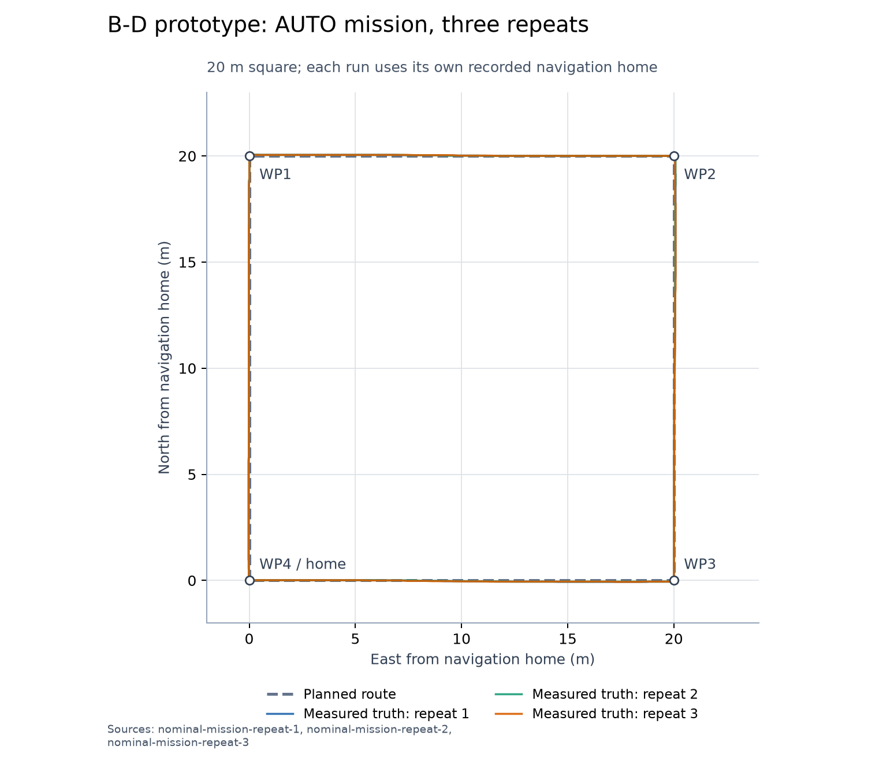
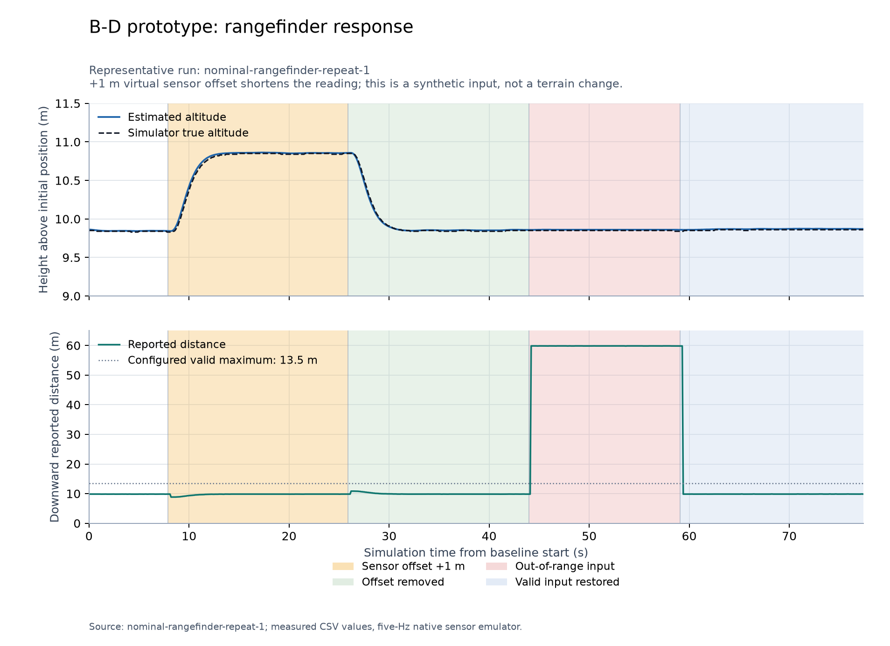

# 実験003：第１弾（B〜D）の機体・自動航路・下向き測距

## 目的

[第１弾の部品表](../../../hardware/prototype-01/README.md)の12.3387kgを機体モデルへ反映し、飛行制御と段階Dの下向き測距・プログラム制御を試験する。水・タンク・散布装置・RTKは含めない。部品の公表重量と仮重量を追跡できるBOMから、総質量・仮の重心・慣性を生成する。

機体・センサーの再現範囲と仮定は[モデル説明](model.md)に記す。実験002の完成形を想定した荷重モデルとは別の設定であり、過去の実験結果は変更しない。

## 結果

2026-11-16に本試験を実施し、**11/11成功**。全回で通常アーム、期待したモードでの飛行・帰還、接地後のディスアーム、非空の機体BINログ保存を確認した。実行したコードは[b114b11](https://github.com/m8k8/drone-sitl/commit/b114b11a92de9dace9dc0cbf7043cd659ed3a8e1)。実行環境・ハッシュ・予備試験の失敗と修正は[実行記録](run-record.md)に残した。

| ケース | 試験 | 回 | 判定 | 質量 kg | 真値着地ずれ m | アーム時間 s |
| --- | --- | ---: | --- | ---: | ---: | ---: |
| nominal | flight | 1 | 成功 | 12.3387 | 0.021 | 99.0 |
| nominal | flight | 2 | 成功 | 12.3387 | 0.024 | 99.0 |
| nominal | flight | 3 | 成功 | 12.3387 | 0.021 | 100.0 |
| nominal | mission | 1 | 成功 | 12.3387 | 0.048 | 108.0 |
| nominal | mission | 2 | 成功 | 12.3387 | 0.045 | 108.0 |
| nominal | mission | 3 | 成功 | 12.3387 | 0.045 | 108.0 |
| nominal | rangefinder | 1 | 成功 | 12.3387 | 0.021 | 122.0 |
| nominal | rangefinder | 2 | 成功 | 12.3387 | 0.024 | 122.0 |
| nominal | rangefinder | 3 | 成功 | 12.3387 | 0.021 | 122.0 |
| mass-low | flight | 1 | 成功 | 11.8387 | 0.029 | 99.0 |
| mass-high | flight | 1 | 成功 | 12.8387 | 0.029 | 99.0 |

アーム時間は各試験のアームからディスアームまでのシミュレーション時間であり、電池を使い切るまでの飛行時間ではない。真値の着地ずれは最大0.048mだった。ただし無風・追加GPS位置雑音0の条件であり、実機がこの精度で帰還することを示さない。

### 基本飛行と重量差

| ケース | 回 | 推定高度範囲 m（離陸点ホバー） | 平均PWM µs | 平均電流 A（参考） | 北20m真値ずれ最大 m |
| --- | ---: | --- | ---: | ---: | ---: |
| nominal | 1 | 9.861–9.888 | 1415.1 | 26.16 | 0.150 |
| nominal | 2 | 9.807–9.838 | 1415.1 | 26.15 | 0.172 |
| nominal | 3 | 9.804–9.827 | 1415.1 | 26.16 | 0.172 |
| mass-low | 1 | 9.842–9.867 | 1408.0 | 25.06 | 0.172 |
| mass-high | 1 | 9.840–9.871 | 1422.4 | 27.27 | 0.150 |

11.8387kg→12.3387kg→12.8387kgで、ホバー時の平均PWMは約1408→1415→1422µs、モデル内電流は約25.06→26.16→27.27Aとなった。同じ推進校正のまま、重量が増えると必要な出力が増える挙動を確認した。北20mでの位置保持も全条件で判定内だった。

PWMは4モーターの指令値の平均。電流は推進系の簡易モデルが出す値で、補機の消費電力を含まない。実機の電流定格・端子発熱・航続時間の検証には使わない。±0.5kgの比較は各1回の確認であり、重量誤差全体の保証ではない。

### 自動航路

| AUTO試験の回 | WP1真値接近 m | WP2 m | WP3 m | WP4 m |
| ---: | ---: | ---: | ---: | ---: |
| 1 | 0.010 | 0.020 | 0.011 | 0.021 |
| 2 | 0.011 | 0.018 | 0.011 | 0.014 |
| 3 | 0.018 | 0.004 | 0.011 | 0.021 |

表は各目標点へ最も近づいた時点の、シミュレーター真値と目標の水平距離。航路全体の最大誤差ではない。4地点の到達通知に加え、各WPを実行中の最近接時点の高度・モードを確認し、最後はミッション内のRTL項目で帰還した。3回とも帰還中はAUTOを維持した。



各回の航法用homeを原点としている。3回の線はほぼ重なる。[SVG版](figures/mission-trajectories.svg)も保存した。

### 下向き測距の制御と異常からの復帰

| 測距試験の回 | 距離を1m短くした時の推定／真値高度変化 m | 偏り解除後の真値高度差 m | 範囲外中の真値高度範囲 m | 復旧後真値高度差 m | コントローラログ証拠 |
| ---: | --- | ---: | --- | ---: | --- |
| 1 | 1.008 / 1.005 | 0.004 | 9.840–9.850 | 0.016 | 記録あり |
| 2 | 1.004 / 1.004 | 0.003 | 9.850–9.860 | 0.013 | 記録あり |
| 3 | 1.007 / 1.004 | 0.004 | 9.840–9.850 | 0.017 | 記録あり |

約1m短い測距を与えると、3回とも機体の真値高度が約1m上がった。つまり距離が表示されるだけでなく、地面追従の高度制御へ入力されている。この結果は、測距が誤ると高度制御も影響を受けることを示している。実地形や光学的な誤測距を再現した試験ではない。

偏り解除後の高度差は最初の基準測定の平均に対する値。範囲外から復旧した後の高度差は、範囲外注入直前の正常測距時の平均に対する値である。

3回とも、範囲外の安定区間ではBINのRFNDが範囲超過、SURFが測距不健康、CTUNの目標地面距離がNaNとなった。復旧後はそれぞれ正常・正常・有限値に戻った。SYS_STATUSの測距健康bitは範囲外でも1だったため、このbitだけでは判定していない。

判定用の安定区間とは別に、異常・復帰直後の待機時間も含めてCSVを集計した。下表は、範囲外注入直前の正常測距時平均からの最大絶対差である。

| 測距試験の回 | 範囲外注入〜復帰直前：最大高度差 推定／真値 m | 復帰開始〜RTL直前：最大高度差 推定／真値 m |
| ---: | --- | --- |
| 1 | 0.0061 / 0.0058 | 0.0191 / 0.0158 |
| 2 | 0.0077 / 0.0152 | 0.0187 / 0.0152 |
| 3 | 0.0063 / 0.0082 | 0.0183 / 0.0182 |

この過渡区間の全サンプルでarmed LOITERを維持した。測距範囲外でも高度は大きく変わらず、通常の気圧計・IMUを使う高度制御が続いた。これは今回注入した範囲外値に対する結果であり、通信断や電源断の検証ではない。



図は測距試験1回目。上段は推定高度と物理真値、下段は受信距離。赤い区間で距離値は約60mになるが、高度は約10mを維持する。[SVG版](figures/rangefinder-response.svg)も保存した。

### 今回確認できた範囲

第１弾の部品表に基づく重量・仮の重心と慣性で、基本飛行、自動航路、下向き測距を使う制御経路が動作した。一方、全搭載機器の動作確認が済んだという意味ではない。FPV・G12無線・Remote ID・主電源配線は重量だけを反映し、実通信・映像・電気的適合は再現していない。

次の精度向上には、購入前は取付寸法と実際のフレーム形状の確認、購入後は完成重量・重心・推力／電流の測定が必要になる。SITL側で追加できる検証は、風、GPS誤差、操縦通信断、測距通信断のような条件別の試験である。障害物回避・実飛行時間・散布制御も今回の対象外とする。

## 試験内容と判定条件

| 条件 | 確認すること |
| --- | --- |
| 基本飛行 | 通常のアームチェック、GUIDEDで10m離陸、LOITER、北20mへ移動、RTL着陸・自動ディスアーム |
| AUTO航路 | 機体へ保存した20m四方の航路をAUTOで実行し、各点到達・真値との距離・帰還を確認 |
| 下向き測距 | 正常値、1mの合成測距バイアスへの追従、バイアス解除、測距範囲外での高度保持、正常測距への復帰 |
| 重量感度 | 基準12.3387kgに対し±0.5kgで基本飛行。同じ推進系のまま出力・高度・位置保持を比較 |

基準機の3種類は各3回、重量感度は各1回とする。±0.5kgは感度を見るための追加条件であり、完成重量の誤差範囲や上下限を保証しない。測距の異常は通信が続く範囲外データであり、UART断線・電源断の試験ではない。

共通条件はArduCopter 4.7.2、正方形X近似、12S 10Ah、CMACの平地、風・乱流0、追加GPS位置雑音0、GPS遅延100ms、シミュレーション速度5倍。測距には±0.02mの一様乱数雑音を加える。3回の反復は同じ設定を新しい保存状態から起動した確認であり、実機の誤差分布を再現した統計評価ではない。

| 項目 | 成功の条件 |
| --- | --- |
| 起動・アーム | 実行中の質量・推進基準質量を照合。`ARMING_SKIPCHK=0`、通常のGPS/EKF・アーム判定を通過。強制アームを使わない |
| 基本ホバー | LOITER切替後8秒待ち、10秒測定。推定・真値の高度9〜11m、水平ずれ各2m以内、50サンプル以上 |
| AUTO | 高度10m、座標（北m, 東m）で(20,0)→(20,20)→(0,20)→(0,0)。各WPの到達通知に加え、AUTO中の真値接近2m以内・推定と真値の高度9〜11mを確認。各WPは2秒待機 |
| 正常測距 | 8秒測定。傾きを補正した測距とシミュレーター真値の差0.5m以内 |
| 測距の偏り | 1m短い測距を与え12秒待ち、6秒測定。推定・真値の平均高度が各0.6〜1.4m上がる。偏りを解除し同じ待ち・測定時間で基準高度の±0.5mへ戻る |
| 範囲外の測距 | 約50m長い値を与え、範囲外受信後5秒待って10秒測定。直前の正常測距時の平均高度から推定・真値とも全サンプル±0.75m以内 |
| 測距の復旧 | 範囲内の受信後8秒待って10秒測定。上記と同じ高度条件。範囲外・復旧直後の待機区間は別途CSVで集計 |
| 測距が制御に使われた証拠 | 各安定測定区間のBINログを検査。正常時`RFND.Stat=4`・`SURF.St`正常・`CTUN.DSAlt`有限、範囲外時は3・不健康bit・NaN、復旧後は正常へ戻る |
| 帰還・着陸 | 期待モードで帰還し、接地・通常ディスアーム、推定と真値の着地ずれ各2m以内・相対高度の絶対値1m未満 |

ホバー・測距中はアーム状態とLOITERを確認し、MAVLinkの真値や観測値は原則1秒以内、heartbeatは2秒以内の新しさを要求する。真値はシミュレーターから取り出す物理状態、推定値はArduCopterのセンサー融合による状態であり、別々に判定する。AUTOの最後はミッション内のRTL項目を実行するため、表示モードはAUTOのまま。測距試験の最後のRTLは試験プログラムからの指示であり、測距異常による自動帰還ではない。

## 再実行する

既存の環境では、`drone`から次を実行する。新しいMacでは先に[セットアップ](../../guides/execution.md)を行う。

```bash
cd sitl
./scripts/prepare-prototype.sh
./scripts/prototype-suite.sh --repeats 3 --output runs/prototype-final-20261116
```

この保存先が既にある場合は別名を指定する。過去のログは上書きしない。`prepare-prototype.sh`はモデルの再生成整合性と既存の推進校正パッチを確認してビルドする。

個別に試す場合は以下を使う。

```bash
./scripts/prototype-test.sh --scenario flight
./scripts/prototype-test.sh --scenario mission
./scripts/prototype-test.sh --scenario rangefinder
```

`./scripts/run.sh`は従来の標準3kg機の対話起動であり、第１弾の設定へ切り替わるコマンドではない。この実験は専用の自動試験として実行する。QGroundControlへの転送は行わず、下記の保存済み時系列を可視化する。

## 可視化する

全11件が成功したsuiteに対し、実行リポジトリのルートで次を実行する。`runs/prototype-final-20261116`は実際の保存先に置き換えられる。

```bash
.venv/bin/python scripts/summarize_prototype.py runs/prototype-final-20261116
.venv/bin/python -m venv .cache/plots-venv
.cache/plots-venv/bin/python -m pip install -r requirements-plots.txt
.cache/plots-venv/bin/python scripts/plot_prototype.py runs/prototype-final-20261116 \
  --output ../docs/sitl/experiments/003-prototype-bd/figures
```

Matplotlibによって、AUTO航路3回の真値軌跡と測距試験1回目の応答をSVG・PNGで生成する。実行ラベルと入力ハッシュを画像メタデータに記録する。これは飛行ログのグラフであり、FPVカメラの映像ではない。

## 再現に必要な記録

各実行は専用SITLインスタンスと新しい保存ディレクトリを使う。ユーザーの対話用SITLへ接続せず、アームチェックを無効化しない。実行時の機体設定・パラメータ・コードの版・バイナリのハッシュ、CSV、機体BINログ、判定結果を保存する。

| 保存物 | 内容 |
| --- | --- |
| suite直下の`suite.json` | 全試験の成否、終了コード、各summaryのSHA-256 |
| 各runの`run.json` | 実行コマンド、コードの版・変更状態、バイナリと入力ファイルのSHA-256 |
| `model.json`・`components.json`・`mass-properties.json`など | その回に使ったモデル・部品配置・パラメータ・試験プログラムのコピー |
| `summary.json` | 判定条件、測定値、時刻、エラー、BINのハッシュと測距の制御状態 |
| `telemetry.csv` | フェーズ別の推定値・真値・測距・電流・PWM・モード等の時系列 |
| `parameters.json`・`sitl.log`・`logs/*.BIN` | 取得パラメータ、起動出力、機体内部ログ |

実測機体や実センサーによる校正は未実施。今回確認するのは記録したモデルと制御プログラムの組合せであり、FPV映像・無線伝搬・電源配線の実機適合を試験した結果ではない。
