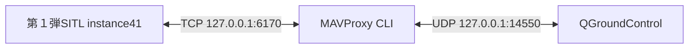

# 第１弾（B〜D）の結果を可視化する

現在のモデルでは、保存したCSVから**飛行軌跡・推定高度と真値・下向き測距への応答**をグラフにします。FPV映像や機体形状の3D表示ではありません。掲載済みの図と測定値は[実験003](../experiments/003-prototype-bd/README.md)にあります。

## 1. 既存の結果を見る

- [AUTO航路3回の真値軌跡](../experiments/003-prototype-bd/figures/mission-trajectories.png)
- [測距の偏り・範囲外・復帰に対する高度応答](../experiments/003-prototype-bd/figures/rangefinder-response.png)

航路図の原点は各回の航法用homeで、単位はmです。測距図は1回目の代表例で、横軸はシミュレーション時間、上段は高度、下段は受信した地面までの距離です。シミュレーターの真値とArduCopterの推定値を分けて描いています。

## 2. 数値表を表示する

`drone/sitl`で実行します。

```bash
.venv/bin/python scripts/summarize_prototype.py runs/prototype-final-20261116
```

新しい試験を使う場合は、最後の引数をそのsuiteの保存先へ置き換えます。

## 3. 図を再生成する

描画には任意のMatplotlib環境を追加します。SITLを動かす`.venv`とは別の環境です。

```bash
.venv/bin/python -m venv .cache/plots-venv
.cache/plots-venv/bin/python -m pip install -r requirements-plots.txt
.cache/plots-venv/bin/python scripts/plot_prototype.py runs/prototype-final-20261116 \
  --output runs/prototype-final-20261116/figures
```

生成するファイルは次の4枚です。

| ファイル | 内容 |
| --- | --- |
| `mission-trajectories.png` / `.svg` | AUTO試験3回の真値軌跡と計画航路 |
| `rangefinder-response.png` / `.svg` | 測距試験1回目の高度と受信距離、入力変更の区間 |

描画スクリプトは完了した成功suiteを要求し、AUTOのrepeat 1〜3と測距のrepeat 1を使います。summaryのハッシュと実行ラベルを照合し、各画像のメタデータにも出典を残します。公開資料の図を更新するときは、どの試験から生成したかを実験記録にも追記してください。

## 4. 生の時系列を確認する

各runの`telemetry.csv`は表計算ソフトでも開けます。

| 列 | 意味 |
| --- | --- |
| `time_boot_ms` | シミュレーター起動後の時刻、ms |
| `phase` | ホバー、移動、測距異常などの試験区間 |
| `relative_alt_m` | ArduCopterが推定した相対高度、m |
| `true_altitude_relative_m` | シミュレーターの物理状態から得た相対高度、m |
| `true_lat_deg` / `true_lon_deg` | シミュレーターの真の緯度・経度 |
| `distance_m` | 下向き測距の受信値、m |
| `mode` / `armed` | 飛行モード番号とアーム状態 |
| `servo1`〜`servo4` | 4モーターのPWM指令 |

位置保持・着陸誤差の意味、測距が制御に使われたかを確認するBIN項目は[実験結果](../experiments/003-prototype-bd/README.md)と[モデル説明](../experiments/003-prototype-bd/model.md)を参照してください。

## 5. 対話起動のリアルタイム表示

`./scripts/run.sh`で第１弾の基準モデルを起動すると、MAVProxyから同じMacのUDP 14550へテレメトリーを転送します。QGroundControlでUDP自動接続を有効にすると、このデータを受信する構成です。自動試験にはこの転送を含めていません。



QGroundControlでは位置・姿勢・高度などの表示ができますが、この環境でのGUI接続・描画は未検証です。導入が必要なら[公式ダウンロード](https://docs.qgroundcontrol.com/Stable_V5.1/en/qgc-user-guide/getting_started/download_and_install.html)と[通信設定](https://docs.qgroundcontrol.com/Stable_V5.1/en/qgc-user-guide/settings_view/comm_links.html)を参照してください。QGCを接続してもFPVカメラの映像は生成されません。

導入済みのMAVProxyだけで数値を確認する場合は、対話起動中に次を入力します。

```text
status GLOBAL_POSITION_INT
status ATTITUDE
status DISTANCE_SENSOR
```

これらはその時点の受信値を表示するコマンドで、保存済みCSVから作るグラフとは別です。
