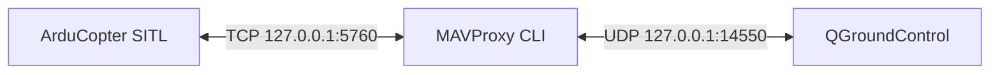

# SITLの可視化方法

確認日：2026-11-16

この文書は、標準機を起動する[`run.sh`](https://github.com/m8k8/drone-sitl/blob/main/scripts/run.sh)とQGroundControl（QGC）を接続し、地図・高度・姿勢・飛行モードを表示する共通ガイドです。`run.sh`はQGCへデータを転送します。各実験専用の自動テストが同じ通信先を使うとは限らないため、実験ごとの可視化・ログ解析手順は[実験一覧](../README.md)から確認してください。

**この文書のQGC手順は公式資料と接続設定を確認したもので、GUIでの接続・表示はまだ実行検証していません。** 標準機ではMAVProxy CLIによる状態確認と基本飛行テストを実施済みです。[実行手順](execution.md)と[実験001の結果](../experiments/001-standard-quad/README.md)も参照してください。第１弾B〜Dについては、[実験003](../experiments/003-prototype-bd/README.md)で保存したCSVから航路と測距応答のグラフを生成・確認しています。

## 1. 現在の構成で見られるもの

| 方法 | 見られるもの | 現在の状態 |
| --- | --- | --- |
| MAVProxy CLI | 高度、位置、姿勢、飛行モードなどの数値 | 導入済み。相対高度の表示を確認済み |
| 保存したCSVとMatplotlib | 飛行軌跡、推定・真値の高度、測距への応答 | [実験003](../experiments/003-prototype-bd/README.md)でSVG・PNGを生成・確認済み。再生成手順も記載 |
| QGroundControl | 地図上の機体位置、飛行軌跡、計器、リアルタイムの数値グラフ | 以下に導入手順を記載。GUI接続は未検証 |
| MAVProxyの`--map`・`--console` | MAVProxy自身の地図・GUI計器 | 現在はGUI依存が未導入。`run.sh`もこれらの引数を受け付けない |
| G06の詳細な3D表示・散布の可視化 | 機体形状、液体や散布の様子 | この手順には含まない。G06の暫定物理モデルの検証は[実験002](../experiments/002-g06-payload/README.md)で扱う |

QGCはSITLが計算した位置・姿勢などを表示する地上局です。QGCを追加しても、機体モデルがG06に変わったり、カメラ映像が生成されたりするわけではありません。

## 2. 通信のつながり



`run.sh`は公式`sim_vehicle.py`を起動し、MAVProxyがSITLのTCPポート5760へ接続します。同時に、MAVProxyが同じMacのUDPポート14550へMAVLinkを転送します。QGCはこのUDPを受信します。[ArduPilotの接続説明](https://ardupilot.org/dev/docs/using-sitl-for-ardupilot-testing.html)

この構成では、QGC用にTCP 5760への接続を追加する必要はありません。以下ではMAVProxyを操作用、QGCを観察用として使います。

## 3. QGroundControlをインストールする

1. [QGroundControl安定版の公式ダウンロードページ](https://docs.qgroundcontrol.com/Stable_V5.1/en/qgc-user-guide/getting_started/download_and_install.html)を開きます。
2. `Mac OS`欄の`QGroundControl.dmg`をダウンロードします。
3. DMGを開き、QGroundControlを`Applications`へドラッグします。
4. アプリケーションフォルダーからQGroundControlを起動します。

確認したStable V5.1の公式要件はmacOS 13以降です。配布物はApple SiliconとIntelの両方でネイティブ動作するUniversal binaryです。ダウンロード時には安定版ページの最新要件を確認してください。daily buildの資料とは対応OSが異なる場合があります。[公式のmacOS導入説明](https://docs.qgroundcontrol.com/Stable_V5.1/en/qgc-user-guide/getting_started/download_and_install.html#mac-os)

## 4. SITLへ接続する

### 通常はUDPの自動接続を使う

1. QGCを起動したままにします。
2. Macのターミナルで、`drone`ディレクトリから次を実行します。

   ```bash
   cd sitl
   ./scripts/run.sh
   ```

3. MAVProxyに`Detected vehicle`や`ArduPilot Ready`が表示されるまで待ちます。GPS・姿勢推定の初期化も少し待ちます。
4. QGCの`Fly`画面へ移動します。機体が認識され、飛行モードや高度などが更新されることを確認します。

QGCにはUDPの自動接続機能があり、標準の自動接続受信ポートは14550です。設定画面では`Application Settings`の`Comm Links`を確認します。表示名は版や表示言語によって多少異なります。[QGCの通信設定](https://docs.qgroundcontrol.com/Stable_V5.1/en/qgc-user-guide/settings_view/comm_links.html)・[UDP自動接続の公式設定定義](https://github.com/mavlink/qgroundcontrol/blob/master/src/Settings/AutoConnect.SettingsGroup.json)

起動場所は公式サンプル地点の`CMAC`です。地図はオーストラリアのキャンベラ付近になります。最初はその場で上昇・保持・降下するため、地図上の水平移動は小さく見えます。

### 自動接続されない場合

1. QGCの`Application Settings` → `Comm Links`で、UDPの自動接続設定を確認します。
2. 手動リンクで試す場合は、同じ14550を二重に使用しないようUDP自動接続を無効にし、必要に応じてQGCを再起動します。
3. `Add New Link`で次の設定を作ります。

   | 設定 | 値 |
   | --- | --- |
   | Name | `Local ArduPilot SITL`など任意の名前 |
   | Type | `UDP` |
   | Local / Listening Port | `14550` |
   | Remote Hosts / Server Addresses | 空欄。MAVProxyから送られてくるデータを待ち受ける |

4. 保存したリンクを`Connect`します。
5. まだ機体が表示されなければ、MAVProxyの起動出力に`--out 127.0.0.1:14550`があるか確認します。

地図だけが空白でモードや高度が更新される場合、機体通信と地図の取得は分けて確認します。地図データの取得にはインターネット接続や適切な地図プロバイダー設定が必要です。

## 5. 飛行中に観察する

最初の飛行は[実行手順](execution.md)に沿って、MAVProxyでGUIDED・アーム・10m離陸・LOITER・RTLを順に実行します。

| 観察対象 | 確認する内容 |
| --- | --- |
| 飛行モード | GUIDED → LOITER → RTLの切り替わり |
| 高度 | 離陸後に約10mへ上昇し、LOITERで大きく変化しないこと |
| 地図・軌跡 | CMAC付近の位置。今回の練習では離陸点付近で保持すること |
| 姿勢・コンパス | ホバリング中の傾きと機首方位 |
| Armed / Disarmed | 飛行中はArmed、着陸後にDisarmedとなること |

QGCの`Fly`画面には地図、テレメトリー値、姿勢・方位計、機体状態が表示されます。表示項目や単位は画面設定に合わせて確認してください。[Fly画面の公式説明](https://docs.qgroundcontrol.com/Stable_V5.1/en/qgc-user-guide/fly_view/fly_view.html)

## 6. 高度や姿勢をグラフで見る

QGCでは`Analyze` → `MAVLink Inspector`から、受信しているMAVLinkメッセージのフィールドをグラフへ追加できます。

1. QGCがSITLに接続された状態で`MAVLink Inspector`を開きます。
2. `GLOBAL_POSITION_INT`を選び、`relative_alt`の値を確認します。
3. 対象フィールドのグラフ用チェック欄を有効にします。
4. 必要に応じて`ATTITUDE`の`roll`・`pitch`も別のグラフへ追加します。

| フィールド | 生データの単位・読み方 |
| --- | --- |
| `GLOBAL_POSITION_INT.relative_alt` | mm。`10000`は相対高度10m |
| `GLOBAL_POSITION_INT.alt` | mm、平均海面基準の高度。相対高度とは異なる |
| `ATTITUDE.roll` / `pitch` | rad。角度表示へ直す場合は180/πを掛ける |

高度と姿勢では単位が違うため、グラフを分けると読み取りやすくなります。`MAVLink Inspector`のリアルタイム表示・グラフ化は公式機能ですが、この環境でのGUI描画は未検証です。[Inspectorの公式説明](https://docs.qgroundcontrol.com/Stable_V5.1/en/qgc-user-guide/analyze_view/mavlink_inspector.html)・[MAVLinkのフィールド定義](https://mavlink.io/en/messages/common.html#GLOBAL_POSITION_INT)

## 7. QGCを入れる前にCLIで数値を見る

起動中のMAVProxyへ入力します。Macのシェルへ入力するコマンドではありません。

```text
status GLOBAL_POSITION_INT
status ATTITUDE
status HEARTBEAT
```

`status`は、その時点でMAVProxyが保持する受信値を表示します。連続グラフではないので、変化を確認するには再入力します。

実験001の手動飛行では`GLOBAL_POSITION_INT.relative_alt`が`9999`、LOITER中に`10000`となることを確認しました。これは相対高度9.999m、10.000mに相当します。他の表示やGUIの検証状況は[実験001の結果](../experiments/001-standard-quad/README.md)で区別しています。

## 8. 現在のMAVProxy GUIについて

既存プロジェクトはCLI用依存だけを固定しています。`wxPython`などを必要とするMAVProxyの地図・GUIコンソールは、現在の環境では使える状態にしていません。

`./scripts/run.sh --map`や`./scripts/run.sh --console`は未対応の引数として終了します。MAVProxy内で`module load map`を入力しても、必要なGUI依存が揃っていません。最初の可視化には、Python環境の変更が不要な上記のQGC接続手順を使います。
